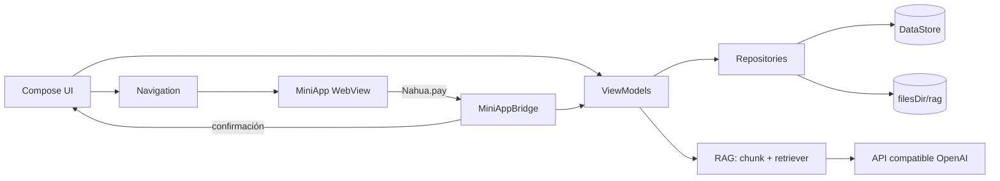

# Nahua · Super App Android

[](https://github.com/ruffol/nahua-superapp/actions/workflows/android.yml)
[](https://kotlinlang.org)
[](https://developer.android.com/jetpack/compose)
[](https://developer.android.com)
[](LICENSE)

Una **super app** al estilo de las apps chinas (WeChat, Alipay, Meituan): un solo binario que
agrupa pagos, transporte, comida, tianguis, mapas, ocio y una IA que responde sobre tus PDFs, con
un **runtime de mini-apps** para que terceros publiquen experiencias sin volver a publicar la app.

Este repositorio es el *shell* funcional: hub de servicios, cartera con pagos reales dentro de la
app, escáner QR, mapas, mascota virtual, tianguis regional, asistente RAG local y siete mini-apps /
features que cobran o consultan a través de las APIs del host.

> **Estado:** v0.2.0 — demo de producto, no lista para producción. No hay backend, KYC, PCI ni
> firma de mini-apps todavía. Ver la hoja de ruta al final.

---

## Qué incluye

- **Hub de servicios** con catálogo único, categorías, búsqueda y accesos rápidos.
- **Cartera Nahua** con saldo, recargas y movimientos persistidos (DataStore, montos en centavos).
- **Pagos desde mini-apps**: las páginas HTML piden `Nahua.pay({...})`; la app muestra una hoja de
  confirmación, debita la cartera y devuelve el `transactionId` al JavaScript.
- **Runtime de mini-apps** basado en WebView aislado, servido por `WebViewAssetLoader` en un origen
  `https://` (sin `file://`, sin tráfico en claro).
- **Nahua IA (RAG local)**: importa PDFs, extrae su texto en el dispositivo, recupera los pasajes
  relevantes y responde con tu API compatible con OpenAI (OpenCode Go por defecto).
- **Mapas** con Leaflet y teselas de OpenStreetMap, con los tianguis de cinco ciudades.
- **Axolote virtual** con estadísticas, niveles y persistencia local.
- **Escáner QR** con flujo de pago simulado (listo para CameraX + ML Kit).
- **Avisos**, **perfil**, tema claro/oscuro y preferencias persistentes.
- **33 tests unitarios** y **CI** en GitHub Actions.

### Mini-apps y features

| App | Tipo | Qué hace | Integración |
| --- | --- | --- | --- |
| **Nahua Ride** | mini-app | destino, tarifa, ETA y viaje | `Nahua.pay` |
| **Nahua Food** | mini-app | menú, carrito y checkout | `Nahua.pay` |
| **Pagar servicios** | mini-app | luz, agua e internet | `Nahua.pay` |
| **Cine** | mini-app | cartelera, funciones y boletos | `Nahua.pay` |
| **Mapas** | mini-app | tianguis y rutas en CDMX, Oaxaca, Puebla, Mérida y GDL | Leaflet + OSM |
| **Axolote** | mini-app | mascota virtual con hambre, ánimo y niveles | `localStorage` |
| **Tianguis** | mini-app | productores de Oaxaca, Puebla, Yucatán y CDMX | `Nahua.pay` |
| **Nahua IA** | feature nativa | RAG sobre tus PDFs con tu propia API | HTTP + PDFBox |

---

## Nahua IA (RAG local)

1. Abre **Servicios → Nahua IA**.
2. Toca el engrane y configura:
   - **Base URL**: `https://opencode.ai/zen/go/v1`
   - **Modelo**: `deepseek-v4-pro` (o `kimi-k2.7-code`, `glm-5.1`, `mimo-v2.5-pro`)
   - **API key**: tu llave de OpenCode Zen / OpenCode Go
3. Agrega un PDF con texto seleccionable (hasta 300 páginas).
4. Pregunta en lenguaje natural: la app recupera hasta 4 fragmentos y los envía junto con tu
   pregunta. La respuesta cita `[Documento, p. N]`.

Privacidad: el PDF y su índice **nunca salen del teléfono**; solo viajan la pregunta y los
fragmentos recuperados. La API key se guarda en el almacenamiento privado de la app (para
producción: Keystore).

Cualquier endpoint compatible con `POST /chat/completions` funciona: OpenAI, OpenRouter, Ollama o
vLLM. Detalles de arquitectura en [docs/RAG.md](docs/RAG.md).

---

## Arquitectura

```
app/
└─ com.nahuanotoca.superapp
   ├─ core/
   │  ├─ data/            repositorios (cartera, sesión, avisos, preferencias)
   │  ├─ data/catalog/    catálogo de servicios
   │  ├─ design/          tema, tipografía, componentes compartidos
   │  ├─ miniapp/         manifiestos, registro y puente JS
   │  ├─ model/           modelos + WalletLedger (aritmética pura)
   │  ├─ navigation/      rutas
   │  ├─ rag/             extracción PDF, chunking, retrieval y cliente LLM
   │  └─ util/            formateo de fechas
   ├─ feature/            home, services, wallet, scan, inbox, profile, miniapp, search, rag
   ├─ ui/                 shell de navegación y fábrica de ViewModels
   ├─ NahuaApplication.kt
   └─ MainActivity.kt
```



Decisiones clave:

- **Sin framework de DI** por ahora: `AppContainer` manual. Migrar a Hilt es mecánico y no toca
  features (documentado en `docs/ARCHITECTURE.md`).
- **DataStore + org.json** en lugar de Room para mantener el build simple; el repo expone flujos,
  así que el cambio de motor no afecta la UI.
- **Dinero en centavos (`Long`)** y `WalletLedger` puro para poder testear las reglas sin Android.
- **Mini-apps en HTML** para iterar rápido; el contrato es `assets/miniapps/index.json`.
- **RAG sin embeddings**: recuperación léxica BM25 ligera, sin descargas de modelos ni red adicional.

Más detalle: [docs/ARCHITECTURE.md](docs/ARCHITECTURE.md), [docs/MINIAPP_SDK.md](docs/MINIAPP_SDK.md)
y [docs/RAG.md](docs/RAG.md).

---

## Cómo compilar

Requisitos:

- JDK 17
- Android SDK con la plataforma **35** (`compileSdk = 35`, `targetSdk = 35`, `minSdk = 26`)

```bash
# 1. Configura el SDK (ruta local, no se versiona)
echo "sdk.dir=/ruta/a/Android/Sdk" > local.properties

# 2. Compila el APK de debug
./gradlew assembleDebug

# 3. Corre los tests unitarios
./gradlew testDebugUnitTest

# 4. Instala en un emulador o dispositivo conectado
./gradlew installDebug
```

El APK queda en `app/build/outputs/apk/debug/app-debug.apk`.

---

## Flujo de pago (de punta a punta)

1. La mini-app llama `Nahua.pay({ amount, concept, merchant })`.
2. `MiniAppBridge` valida el monto y lo publica en el hilo principal.
3. La app muestra una hoja de confirmación con el saldo disponible.
4. Al confirmar, `WalletRepository` debita el saldo y registra el movimiento.
5. El resultado (`transactionId`, `balanceCents`) se devuelve al JavaScript y la mini-app muestra
   su pantalla de éxito.

Si el usuario cancela o no hay saldo, el puente resuelve el `Promise` con
`{ status: 'error', error: 'cancelled' | 'insufficient_funds' }`.

---

## Hoja de ruta

- [x] Mini-apps de mapas, mascota virtual, tianguis y RAG local sobre PDFs.
- [ ] Backend real (cuentas, ledger doble entrada, webhooks) y OAuth/OIDC.
- [ ] Embeddings on-device (MediaPipe/ONNX) para retrieval semántico.
- [ ] Mini-apps firmadas (manifiesto + hash) y permisos granulares.
- [ ] CameraX + ML Kit para escaneo QR real.
- [ ] Módulos Gradle (`core:design`, `core:data`, `feature:*`) y Hilt.
- [ ] Pagos con tarjeta/SPEI, KYC y cumplimiento PCI.
- [ ] Notificaciones push y centro de soporte.

---

## Contribuir

Lee [CONTRIBUTING.md](CONTRIBUTING.md). Las ideas y los issues son bienvenidos.

## Licencia

MIT © 2026 Nahua contributors. Ver [LICENSE](LICENSE).
