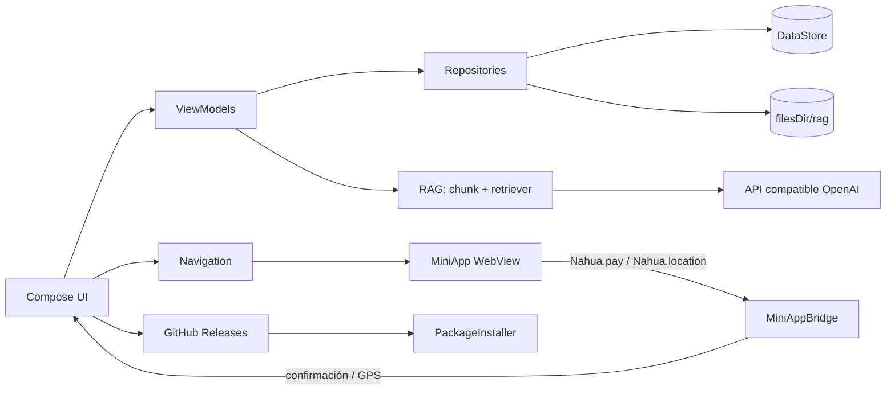

# Nahua · Super App de Colima

[](https://github.com/ruffol/nahua-superapp/actions/workflows/android.yml)
[](https://kotlinlang.org)
[](https://developer.android.com/jetpack/compose)
[](https://developer.android.com)
[](LICENSE)

Una **super app** hecha para **Colima**: pagos, transporte, comida, tianguis de productores locales,
mapa **offline** con GPS, mascota virtual, ocio y **Nahuanotoka**, un asistente que responde sobre
tus PDFs con tu propia API. Todo en un solo binario, con un **runtime de mini-apps** y
**actualizaciones OTA** desde GitHub Releases.

> **Estado:** v0.3.0 — demo funcional, no lista para producción (sin backend, KYC ni PCI).

---

## Lo que incluye

- **Mapa offline de Colima** con teselas empaquetadas (z9–13 estatal, z14–15 metropolitano) y
  **GPS** para centrarte; teselas en línea de OpenStreetMap como respaldo.
- **Tianguis de Colima**: productores de Colima, Villa de Álvarez, Comala, Tecomán, Manzanillo y
  Armería, con canasta y pago desde la cartera.
- **Nahuanotoka (RAG local)**: importa PDFs, extrae su texto en el teléfono y pregunta con tu API
  compatible con OpenAI (OpenCode Go por defecto).
- **Actualizaciones OTA**: desde *Perfil → Versión* la app busca la última release en GitHub, la
  descarga y la instala sin volver a pasar un APK.
- **Hub de servicios**, cartera con DataStore, pagos entre mini-apps, escáner QR, avisos, perfil y
  tema claro/oscuro.
- **40 tests unitarios** y CI en GitHub Actions.

### Mini-apps y features

| App | Tipo | Qué hace | Integración |
| --- | --- | --- | --- |
| **Mapas** | mini-app | mapa offline de Colima, tianguis por municipio y “mi ubicación” | Leaflet + GPS |
| **Tianguis** | mini-app | productores colimenses de seis municipios | `Nahua.pay` |
| **Nahua Ride** | mini-app | destino, tarifa, ETA y viaje | `Nahua.pay` |
| **Nahua Food** | mini-app | menú, carrito y checkout | `Nahua.pay` |
| **Pagar servicios** | mini-app | luz, agua e internet | `Nahua.pay` |
| **Cine** | mini-app | cartelera, funciones y boletos | `Nahua.pay` |
| **Axolote** | mini-app | mascota virtual con hambre, ánimo y niveles | `localStorage` |
| **Nahuanotoka** | feature nativa | RAG sobre tus PDFs con tu API | HTTP + PDFBox |

---

## Mapa offline de Colima

- Teselas `{z}/{x}/{y}.png` empaquetadas en `assets/miniapps/mapa/tiles` (2,151 teselas, ~14 MB).
- Cobertura: estado de Colima en z9–13; zona metropolitana Colima–Villa de Álvarez–Comala en z14–15.
- Si falta una tesela (o alejas el mapa fuera de la cobertura), Leaflet usa OpenStreetMap en línea.
- Botón **📍 Mi ubicación**: pide permiso de ubicación la primera vez y dibuja tu posición con su
  precisión.
- Atribución a OpenStreetMap en el mapa y en el pie.

## Nahuanotoka (RAG local)

1. **Servicios → Nahuanotoka → engrane**.
2. Base URL `https://opencode.ai/zen/go/v1`, modelo `deepseek-v4-pro` y tu API key de OpenCode Go.
3. **Agregar PDF** (con texto seleccionable, hasta 300 páginas) y pregunta.

El documento y su índice se quedan en el teléfono; solo viajan la pregunta y 4 fragmentos. La
respuesta cita `[Documento, p. N]`. Detalles en [docs/RAG.md](docs/RAG.md).

## Actualizaciones OTA

1. **Perfil → Versión** abre el panel de actualizaciones (o *Actualizar app*).
2. La app consulta `releases/latest` del repo, compara versiones y muestra las notas.
3. **Descargar e instalar** baja el APK a caché, verifica el SHA-256 cuando GitHub lo publica y
   abre el instalador del sistema (la primera vez hay que permitir “instalar apps desconocidas”
   para Nahua).

Publicar una versión nueva:

```bash
git tag v0.3.1
git push origin v0.3.1
```

El workflow `release.yml` compila el APK con `versionName=0.3.1` y `versionCode=301`, lo firma y lo
adjunta a la release. En el teléfono basta con tocar *Buscar actualizaciones*.

> **Firma:** el repo incluye `signing/nahua-demo.keystore` a propósito para que las compilaciones de
> CI y las locales compartan firma y puedan actualizarse entre sí. Es una llave de demo, pública:
> reemplázala antes de distribuir fuera de este repositorio.

---

## Arquitectura

```
app/
└─ com.nahuanotoca.superapp
   ├─ core/
   │  ├─ data/            cartera, sesión, avisos, preferencias
   │  ├─ data/catalog/    catálogo de servicios
   │  ├─ design/          tema y componentes
   │  ├─ location/        LocationManager + permisos (GPS de las mini-apps)
   │  ├─ miniapp/         manifiestos, registro y puente JS (pago, ubicación)
   │  ├─ model/           modelos + WalletLedger (aritmética pura)
   │  ├─ navigation/      rutas
   │  ├─ rag/             extracción PDF, chunking, retrieval y cliente LLM
   │  ├─ update/          GitHub Releases + PackageInstaller
   │  └─ util/            formateo de fechas
   ├─ feature/            home, services, wallet, scan, inbox, profile, miniapp, search, rag, update
   ├─ ui/                 shell de navegación y fábrica de ViewModels
   ├─ NahuaApplication.kt
   └─ MainActivity.kt
```



Decisiones: DI manual (`AppContainer`), DataStore en lugar de Room, dinero en centavos, mini-apps
HTML, RAG léxico sin embeddings y mapa raster offline para no depender de Google Play Services.

Más detalle: [docs/ARCHITECTURE.md](docs/ARCHITECTURE.md), [docs/MINIAPP_SDK.md](docs/MINIAPP_SDK.md)
y [docs/RAG.md](docs/RAG.md).

---

## Cómo compilar

Requisitos: JDK 17 y Android SDK con la plataforma **35**.

```bash
echo "sdk.dir=/ruta/a/Android/Sdk" > local.properties
./gradlew assembleDebug        # APK de debug
./gradlew testDebugUnitTest    # 40 tests
./gradlew installDebug
```

El APK queda en `app/build/outputs/apk/debug/app-debug.apk`.

---

## Privacidad

- Los PDFs se procesan en el dispositivo; solo se envían pregunta y fragmentos a tu API.
- La ubicación se usa únicamente cuando tocas “Mi ubicación” dentro del mapa.
- La API key se guarda en el almacenamiento privado de la app (Keystore recomendado en producción).

---

## Hoja de ruta

- [ ] Backend real (cuentas, ledger de doble entrada, webhooks) y OAuth/OIDC.
- [ ] Embeddings on-device para búsqueda semántica en Nahuanotoka.
- [ ] Firma de mini-apps y permisos granulares.
- [ ] CameraX + ML Kit para QR real.
- [ ] Módulos Gradle y Hilt.

## Contribuir

Lee [CONTRIBUTING.md](CONTRIBUTING.md).

## Licencia

MIT © 2026 Nahua contributors. Ver [LICENSE](LICENSE).
