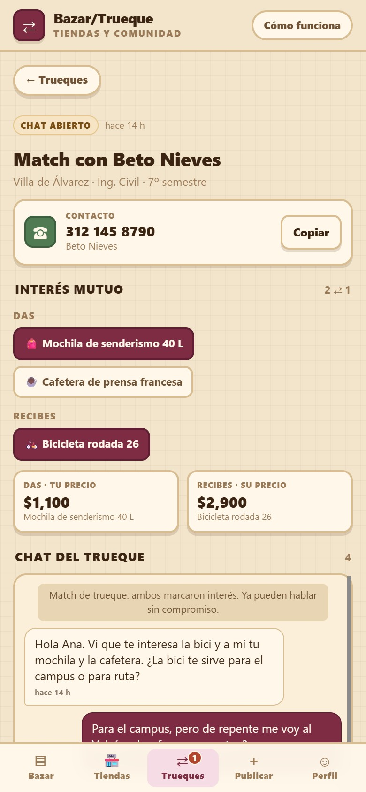
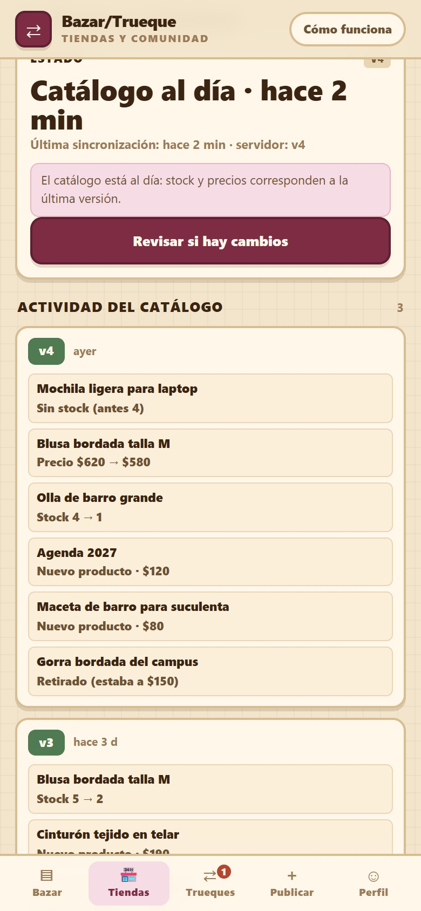
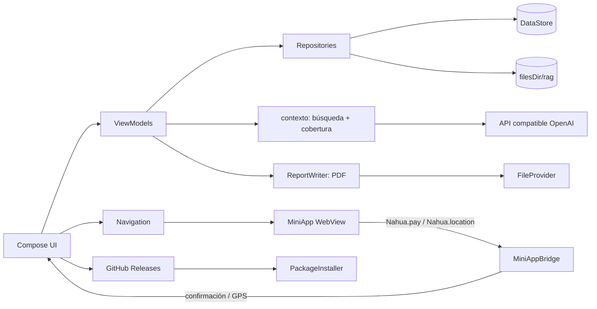

# Nahua · Super App de Colima

[](https://github.com/ruffol/nahua-superapp/actions/workflows/android.yml)
[](https://kotlinlang.org)
[](https://developer.android.com/jetpack/compose)
[](https://developer.android.com)
[](LICENSE)

Una **super app** hecha para **Colima**: pagos, transporte, un **bazar/trueque comunitario**,
mapa **offline** con GPS, mascota virtual y **Nahuanotoka**, un estudio *pixel art* que convierte tus PDFs
en mesas de trabajo por materia: resúmenes con página, ideas propias, correlación entre documentos,
figuras y un PDF listo para exponer. Todo en un solo binario, con un **runtime de mini-apps** y
**actualizaciones OTA** desde GitHub Releases.

> **Estado:** v0.17.0 — demo funcional, no lista para producción (sin backend, KYC ni PCI).

---

## Lo que incluye

- **Mapa estatal de Colima** con teselas propias (z9–16, Natural Earth + OSM + cartografía
  geoestadística del INEGI), manzanas y ejes viales de las localidades, estilo de papel cálido,
  **GPS en vivo** con coordenadas, velocidad y rumbo, ruta directa y búsqueda estatal.
- **Bazar/Trueque y tiendas oficiales**: un solo mercado. Arriba, los banners de las
  **organizaciones oficiales** (venden todo el año y siempre tienen stock, así que tienen lugar
  permanente); debajo, el bazar de la comunidad. Cada quien pone **su precio** —la app ya no valora
  objetos— y el trueque sólo se abre cuando el interés es mutuo. El catálogo de las tiendas se
  sincroniza por deltas, avisa si está desactualizado y guarda la **actividad** (cambios de precio,
  stock, altas y bajas) para auditar fraudes. Cualquier artículo o usuario se puede **reportar**.
- **Nahuanotoka (mesas de estudio)**: crea una mesa por materia, agrega varios PDFs, pide resumen,
  ideas, correlación o guion de exposición, revisa los tokens gastados y exporta el análisis a PDF.
- **Importación en segundo plano** con WorkManager: cierra la app y la indexación sigue.
- **Biblioteca en Room** con migración automática del índice anterior.
- **OCR local** (ML Kit) para PDFs escaneados, en segundo plano.
- **Búsqueda híbrida opcional** (BM25 + vectores con RRF) si configuras un endpoint `/embeddings`.
- **Actualizaciones OTA**: desde *Perfil → Versión* la app busca la última release en GitHub, la
  descarga y la instala sin volver a pasar un APK.
- **Hub de servicios**, cartera con DataStore, pagos entre mini-apps, escáner QR, avisos, perfil y
  tema claro/oscuro.
- **Emulador de Game Boy, Color y Advance**: mini-app inmersiva con EmulatorJS 4.2.3 (núcleos
  mGBA y gambatte en WebAssembly), Super Mario Bros. Deluxe incluido, 100 % offline, controles
  táctiles que se recalculan al girar y partidas que sobreviven al cierre.
- **156 tests unitarios** y CI en GitHub Actions.

### Mini-apps y features

| App | Tipo | Qué hace | Integración |
| --- | --- | --- | --- |
| **Mapas** | mini-app | mapa estatal z9–16 con manzanas, GPS, rutas y búsqueda | Leaflet + GPS + INEGI |
| **Bazar/Trueque** | mini-app | tiendas oficiales con stock, catálogo versionado, trueque con match y reportes | `Nahua.pay` · `Nahua.announce` · `localStorage` |
| **Nahua Ride** | mini-app | destino, tarifa, ETA y viaje | `Nahua.pay` |
| **Pagar servicios** | mini-app | luz, agua e internet | `Nahua.pay` |
| **Yōlcatl** | mini-app | criatura viva: IA autónoma, escenas 3D vóxel, accesorios y mosaico del alma | `localStorage` |
| **Emulador** | mini-app | Game Boy, Color y Advance + Mario incluido, sin red | EmulatorJS 4.2.3 (mGBA + gambatte) · `Nahua.pickRom` |
| **Nahuanotoka** | feature nativa | mesas de estudio: resumen, ideas, correlación y PDF | HTTP + PDFBox |

---

## Mapa estatal de Colima

- **Paquete offline**: 3,686 teselas (~10 MB) en `assets/miniapps/mapa/tiles`. La base z9–13 es PNG
  (Natural Earth + OSM); el detalle z14–16 es **WebP** y pesa casi la mitad que el PNG equivalente.
  Se renderiza a 2× y se reduce con LANCZOS para que calles y etiquetas no salgan dentadas.
- **Detalle urbano del INEGI**: se integró la *Cartografía Geoestadística Urbana y Rural Amanzanada,
  junio 2016* de Colima: **171 localidades, 17,148 manzanas, 15,812 ejes viales y 224 servicios**
  (plazas, mercados, iglesias, escuelas, hospitales). Las manzanas y calles se dibujan sobre la base
  de OSM/Natural Earth.
- **Todo Colima está descargado**: no hay capa online ni peticiones de red. La base z9–13 cubre
  todo el estado; z14–15 cubren todas las localidades amanzanadas y z16 las zonas urbanas de mayor
  densidad (Colima–Villa, Manzanillo, Tecomán, Comala, Armería, Coquimatlán, Cuauhtémoc, Minatitlán
  y otras). En una zona rural sin z16 se ve la base z13 ampliada, nunca un hueco ni un error.
  z17 escala z16 ×2.
- **Interfaz limpia**: sólo buscador, barra de GPS y el botón **◎** para centrar el mapa en tu
  ubicación. No hay panel de lugares, ni chips de municipios, ni botones de acercar/alejar; el zoom
  se hace con pellizco.
- **Buscar en todo el estado**: además de tianguis y plazas, el buscador incluye **395 localidades y
  servicios del INEGI** (plazas, mercados, iglesias, escuelas, hospitales). Los servicios también
  aparecen como etiquetas dentro de las teselas, sin una capa flotante que estorbe.
- **GPS en vivo**: `LocationProvider` usa `LocationManager` (sin Google Play Services) y emite un
  flujo con latitud, longitud, precisión, velocidad, rumbo y altitud. El mapa dibuja tu posición con
  pulso, círculo de precisión y cono de rumbo; puedes seguirte o moverte libremente por el mapa.
  El seguimiento se pausa al ocultar la app para no gastar batería.
- **Coordenadas**: la barra superior muestra lat/lng, precisión y velocidad en tiempo real; al
  tocarla copia las coordenadas al portapapeles.
- **Ir a un lugar**: busca un tianguis, una localidad, un servicio o escribe coordenadas
  (`19.2433, -103.7250`). El mapa traza la distancia directa con rumbo y ETA a pie y en auto, y
  **Navegar** abre la app de mapas del sistema con el destino ya puesto (`geo:`).
- **Rendimiento**: una sola capa de detalle estatal con `maxNativeZoom`, `keepBuffer` y caché de
  WebView; no hay peticiones de red para el mapa. Si una tesela falta, el hueco es transparente y se
  ve la capa inferior, nunca un error 403.
- Atribución a **OpenStreetMap** y **INEGI** en el mapa y en el pie.

### Datos fuente y descargas

La cartografía del INEGI es de consulta y descarga gratuita; respeta sus términos y cita la fuente.

| Dataset | Uso en el mapa | Descarga directa |
| --- | --- | --- |
| Cartografía Geoestadística Urbana y Rural Amanzanada, junio 2016, Colima (SHP, 29.15 MB) | manzanas, ejes viales, servicios | [702825218768_s.zip](https://www.inegi.org.mx/contenidos/productos/prod_serv/contenidos/espanol/bvinegi/productos/geografia/CGURA_Junio2016/Colima/702825218768_s.zip) |
| Topografía 1:50 000, E13B44 Colima, serie III (SHP, 10.74 MB) | calles rurales, curvas, hidrografía | [702825003010_s.zip](https://www.inegi.org.mx/contenidos/productos/prod_serv/contenidos/espanol/bvinegi/productos/geografia/imagen_cartografica/1_50_000/702825003010_s.zip) |
| Topografía 1:50 000, E13B34 Comala, serie III (SHP, 12.15 MB) | norte del estado | [702825002919_s.zip](https://www.inegi.org.mx/contenidos/productos/prod_serv/contenidos/espanol/bvinegi/productos/geografia/imagen_cartografica/1_50_000/702825002919_s.zip) |
| Topografía 1:50 000, E13B43 Manzanillo, serie III (SHP, 13.86 MB) | costa y puerto | [702825268398_s.zip](https://www.inegi.org.mx/contenidos/productos/prod_serv/contenidos/espanol/bvinegi/productos/geografia/imagen_cartografica/1_50_000/702825268398_s.zip) |
| Topografía 1:50 000, E13B54 Tecomán, serie III (SHP, 5.68 MB) | sur del estado | [702825268435_s.zip](https://www.inegi.org.mx/contenidos/productos/prod_serv/contenidos/espanol/bvinegi/productos/geografia/imagen_cartografica/1_50_000/702825268435_s.zip) |
| Topografía digital 1:250 000, condensado estatal serie IV (SHP, 3.89 MB) | visión estatal y rural | [702825208813_s.zip](https://www.inegi.org.mx/contenidos/productos/prod_serv/contenidos/espanol/bvinegi/productos/geografia/conden_estatales/serie_iv/702825208813_s.zip) |
| Carreteras y vialidades urbanas, edición 1.0, Colima (SHP, 2.51 MB) | red carretera estatal | [702825291884_s.zip](https://www.inegi.org.mx/contenidos/productos/prod_serv/contenidos/espanol/bvinegi/productos/geografia/carr_vial/Colima/702825291884_s.zip) |
| Modelo Digital de Elevación, Colima (BIL, 2.94 MB) | relieve y futura sombra de terreno | [702825547769_b.zip](https://www.inegi.org.mx/contenidos/productos/prod_serv/contenidos/espanol/bvinegi/productos/geografia/imagen_cartografica/1_250_000/mde/702825547769_b.zip) |
| Uso del suelo y vegetación, serie III, Colima (SHP, 7.90 MB) | cobertura vegetal y rural | [702825229573_s.zip](https://www.inegi.org.mx/contenidos/productos/prod_serv/contenidos/espanol/bvinegi/productos/geografia/tematicas/Uso_suelo_hist/1_250_00/serie_III/702825229573_s.zip) |

Cada ficha del catálogo del INEGI (por ejemplo
[`upc=702825218768`](https://www.inegi.org.mx/app/biblioteca/ficha.html?upc=702825218768)) muestra el
mismo enlace de descarga y los metadatos. Las hojas 1:50 000 restantes (E13B24, E13B25, E13B32,
E13B33, E13B35, E13B41, E13B42, E13B45, E13B53, E13B55, E13B64) siguen el patrón
`.../geografia/imagen_cartografica/1_50_000/<UPC>_s.zip`; el UPC de cada una está en el CSV que
exportaste.

## Bazar/Trueque y tiendas oficiales

Un solo mercado dentro de la app (`assets/miniapps/bazar/`): arriba los banners de las
organizaciones oficiales —venden todo el año y tienen stock— y debajo el bazar de la comunidad
estudiantil. La portada ya no lleva bloque de texto: son los banners.

<p align="center">
  
  
  
</p>

1. **Tiendas oficiales**: cada banner abre la tienda, que ordena primero los productos que ella
   **fijó** para impulsar la venta y después los últimos agregados. Cada producto muestra su stock
   («8 disponibles») o «Agotado».
2. **Catálogo con frescura**: un chip dice si el catálogo está **al día** o **sin actualizar desde
   hace X**. En ese estado, cada tarjeta advierte que puede faltar stock y la compra pide una segunda
   confirmación antes de cobrar.
3. **Actividad**: cada versión guarda qué cambió —«precio $620 → $580», «stock 4 → 1», altas y
   bajas— con fecha. Las versiones anteriores se consultan completas, incluidos los productos
   retirados. Es el registro para reclamar un cobro o reportar un engaño.
4. **Publicar**: título, descripción, ícono, categoría, estado y **el precio que tú pones**. El bazar
   ya no valora objetos ni sugiere precios.
5. **Marcar «Me interesa»**: es **privado**. Nadie recibe aviso y el dueño sólo ve un conteo anónimo
   («3 personas marcaron interés en tus objetos»). Así nadie truequea por compromiso o presión social.
6. **Match**: cuando la otra persona también marca algo tuyo, el sistema abre el chat y avisa a los
   dos con nombres y objetos. Recién ahí se comparte el contacto: **nombre + teléfono**, nunca un
   `@usuario`.
7. **Cerrar el trato**: se elige punto de encuentro, se puede acordar efectivo de un lado y se marca
   el intercambio al entregar. El historial del chat sobrevive al cierre.
8. **Reportes**: cualquier artículo o usuario se puede reportar por artículo prohibido, precio
   engañoso, falta de stock, actitud irrespetuosa, spam u otro motivo; queda con fecha y se manda a
   revisión.

El bundle guarda la comunidad en `localStorage` (`nahua.bazar.v4`) y el catálogo en su propio
registro versionado (`nahua.bazar.catalogo.v1`). Contrato del catálogo en
[CATALOGO_API.md](docs/CATALOGO_API.md); requisitos para conectar tu servidor en
[Catalogo-Servidor-Requisitos.pdf](docs/Catalogo-Servidor-Requisitos.pdf); la lógica del catálogo se
prueba con `node scripts/test-bazar-catalogo.js`.


## Emulador (Game Boy, Color y Advance)

Una mini-app inmersiva para jugar cartuchos de **Game Boy, Game Boy Color y Game Boy Advance**
dentro de Nahua, sin red y sin tocar una línea de NDK.

- **Motor**: [EmulatorJS](https://emulatorjs.org/) 4.2.3 con dos núcleos compilados a WebAssembly,
  vendorizados sin tocar en `assets/miniapps/gba/emulatorjs/` con `scripts/fetch-emulatorjs.ps1`:
  **mGBA** para Advance y **gambatte** para GB/GBC. Se incluyen las variantes normal y `-legacy`
  (equipos sin WebGL2) y las localizaciones en-US/es-ES. La extensión del archivo elige el núcleo:
  `.gba/.agb/.bin` → mGBA, `.gbc/.gb` → gambatte.
- **Un juego incluido, de demostración**: `games/smbdx.gbc` (Super Mario Bros. Deluxe) viaja en el
  APK con su tarjeta «incluido» para que el emulador se pueda probar sin cargar nada. El resto de
  ROMs son del usuario: tocas **Cargar ROM**, el selector del sistema (`OpenDocument`) te deja
  elegir el archivo, y el anfitrión lo copia a `filesDir/roms` validando extensión y tope de
  64 MiB, con deduplicación por SHA-256 (el nombre final lleva el `sha8` y conserva la extensión de
  la consola). La página lo recibe como URL `https` del propio origen: nunca hay `file://` ni URIs
  de contenido en el WebView.
- **Offline de verdad**: cualquier subrequest a otro origen se responde con un 404 vacío en
  `shouldInterceptRequest`, así que ni siquiera el *failsafe* de EmulatorJS hacia su CDN puede
  generar tráfico.
- **Inmersivo y horizontal**: el manifiesto declara `display: "immersive"` +
  `orientation: "landscape"`; el anfitrión oculta las barras del sistema, rota a horizontal y
  deja solo un botón ✕ flotante. `configChanges` evita que la rotación recre la Activity (y el
  juego). El ciclo de vida pausa el WebView en segundo plano para que el audio no siga sonando.
- **Partidas**: EmulatorJS guarda SRAM y estados en IndexedDB del origen, keyficado por el nombre
  estable de la ROM; cierra la app, vuelve y **Continuar** te deja donde estabas. Si el proceso
  de render muere (OOM de GPU), la app sobrevive y ofrece reintentar.
- **Licencias**: EmulatorJS es **GPL-3.0**; el texto completo y el aviso viven en
  `assets/licenses/`. Es un bundle estático sin modificar, integrado por configuración
  (`EJS_*`), no código enlazado: el proyecto sigue siendo MIT y el emulador se puede quitar
  borrando una carpeta del APK.
- **Controles que se sienten nativos**: los botones del gamepad son HTML, así que la vibración la
  ejecuta el anfitrión (`Nahua.haptic` → `performHapticFeedback`, sin permiso `VIBRATE` y
  respetando el ajuste del sistema) con un tope de 40 ms por pulsación.
- **Joystick y controles a tu medida**: el mando izquierdo es un **joystick** (no una cruceta) y el
  panel de **Ajustes** ajusta **tamaño, altura y margen lateral** del gamepad, además de alternar
  joystick/cruceta y mano (diestro/zurdo). Tamaño y posición se **recalculan al girar el teléfono**
  (`resize`, `orientationchange` y `visualViewport`, con debounce): EmulatorJS mide el gamepad en
  px fijos, así que el layout es propio y escala según el lado corto de la pantalla. El panel
  también trae filtros de imagen (Pixel/LCD/CRT/Suave), avance rápido ×2/×3/×5, rebobinar, ranuras
  de guardado 1–5, guardado automático de pila y contador de FPS.
- **Pantalla a la medida del cartucho**: el canvas conserva la proporción original (GB/GBC
  160×144, GBA 240×160) y se coloca **debajo de una franja libre superior** —los teléfonos tienen
  esquinas redondeadas y cámara en el borde, y ahí el juego se recortaba—, centrado en el hueco
  que deja el mando. En esa franja viven los accesos: **Ajustes** abre el menú del motor
  (guardados, trucos, avance rápido, captura) y **Mando** el panel de controles.
- **Vertical fijo**: un Game Boy es vertical y así el mando cabe en pantalla; girar el teléfono no
  reacomoda nada a media partida.
- **Medido, no supuesto**: cada partida publica un reporte `[perf]` en logcat (frame pacing +
  latencias de WebAudio) y `scripts/gba-perf.ps1` lo convierte en el veredicto Go/No-Go sobre
  pasar a un núcleo nativo. Criterio y procedimiento en [docs/GBA-PERF.md](docs/GBA-PERF.md).

<p align="center">
  
</p>

## Nahuanotoka (mesas de trabajo)

**El problema:** tienes doce PDFs y una exposición en tres días. **La solución:** una mesa por
materia que guarda tus documentos, tu contexto, tus consultas y lo que llevas gastado.

1. **Servicios → Nahuanotoka → Nueva mesa** (nombre, materia y contexto: público, duración, tono).
2. **Agregar PDF o EPUB** (varios a la vez). Se limpian encabezados y números de página, se parten
   en bloques de 450 palabras con 50 de traslape y las figuras de los PDFs quedan como galería.
3. **Herramientas**: *Resumen*, *Ideas nuevas*, *Correlación*, *Guion de exposición*, *Glosario* y
   *Preguntas de repaso*. Con varios libros se envían los 3 mejores fragmentos de cada uno y la
   **Correlación** usa dos pasadas (una ficha por obra y luego el cruce). También puedes escribir la orden
   (“compárame los libros”, “hazme un resumen”) y el enrutador la ejecuta.
   Las respuestas llegan **en streaming**, token por token.
4. **Pregunta libre** en el compositor. Las respuestas citan `[Documento, p. N]`.
5. **PDF** exporta el análisis (portada, encabezados, tablas, fuentes y paginación) y lo comparte.
6. **Tokens**: entrada, salida y total por mesa y por respuesta.
7. **Caché de respuestas**: repite una consulta y no gasta tokens; la mesa acumula aciertos y
   tokens ahorrados.
8. **Copiar y descargar cada respuesta** en PDF, Markdown o TXT, con un lector a pantalla completa
   para las respuestas largas.
9. **Dictado local** con el reconocimiento del teléfono (modo offline cuando hay paquete de idioma).

Por defecto usa **DeepSeek V4.1 Flash** (`deepseek-v4.1-flash`) vía OpenCode Go: es el modelo más
barato para estudiar con muchos PDFs y su contexto alcanza para varias lecturas a la vez. Puedes
cambiar base URL y modelo a cualquier API compatible con OpenAI.

**Requiere API:** el texto se indexa en el teléfono, pero la redacción (resumen, ideas, correlación)
la hace siempre el modelo configurado. Si la API falla o falta la llave, la app muestra el error y
abre la configuración en lugar de inventar una respuesta.

Los documentos se quedan en el teléfono; sólo viajan la pregunta y los fragmentos elegidos.
Detalles de arquitectura, algoritmo y límites en [docs/RAG.md](docs/RAG.md).

## Actualizaciones OTA

1. **Perfil → Versión** abre el panel de actualizaciones (o *Actualizar app*).
2. La app consulta `releases/latest` del repo, compara versiones y muestra las notas.
3. **Descargar e instalar** baja el APK a caché, verifica el SHA-256 cuando GitHub lo publica y
   abre el instalador del sistema (la primera vez hay que permitir “instalar apps desconocidas”
   para Nahua).

Publicar una versión nueva:

```bash
git tag v0.5.1
git push origin v0.5.1
```

El workflow `release.yml` deriva la versión de la etiqueta (`0.17.0` → `versionCode=1700`, con la
fórmula *mayor×10000 + menor×100 + parche*), compila el **variant release** con `assembleRelease`
(R8 + firma demo), verifica la firma con `apksigner` y adjunta `nahua-<versión>.apk` a la release.
En el teléfono basta con tocar *Buscar actualizaciones*.

> **Firma:** el repo incluye `signing/nahua-demo.keystore` a propósito para que las compilaciones de
> CI y las locales compartan firma y puedan actualizarse entre sí. Es una llave de demo, pública:
> reemplázala antes de distribuir fuera de este repositorio.

---

## Arquitectura

```
app/
└─ com.nahuanotoca.superapp
   ├─ core/
   │  ├─ data/            cartera, sesión, avisos, preferencias
   │  ├─ data/catalog/    catálogo de servicios
   │  ├─ design/          tema y componentes
   │  ├─ location/        LocationManager, fix puntual y flujo GPS en vivo
   │  ├─ miniapp/         manifiestos, registro y puente JS (pago, GPS, rutas, bazar y avisos)
   │  ├─ model/           modelos + WalletLedger (aritmética pura)
   │  ├─ navigation/      rutas
   │  ├─ rag/             PDF (texto y figuras), índice, contexto, LLM, PDF de salida
   │  ├─ update/          GitHub Releases + PackageInstaller
   │  └─ util/            formateo de fechas
   ├─ feature/            home, services, wallet, scan, inbox, profile, miniapp, search, rag, update
   │  └─ rag/            mesas de estudio (lista, detalle, herramientas, exportar PDF)
   ├─ ui/                 shell de navegación y fábrica de ViewModels
   ├─ NahuaApplication.kt
   └─ MainActivity.kt
```



Decisiones: DI manual (`AppContainer`), DataStore y JSON en `filesDir` en lugar de Room, dinero en
centavos, mini-apps HTML, recuperación léxica por raíz + cobertura por documento (sin embeddings) y
mapa raster offline para no depender de Google Play Services.

Orquestador de herramientas: [docs/AGENT.md](docs/AGENT.md). Evaluación con el corpus real: [docs/EVAL.md](docs/EVAL.md).

Informe técnico del RAG: [docs/Nahuanotoka-Informe-RAG.pdf](docs/Nahuanotoka-Informe-RAG.pdf).
Auditoría y línea base (plan Nahua AI): [docs/AUDIT.md](docs/AUDIT.md) · [docs/BASELINE.md](docs/BASELINE.md) · [corpus de evaluación](docs/eval/README.md).

Más detalle: [docs/ARCHITECTURE.md](docs/ARCHITECTURE.md), [docs/MINIAPP_SDK.md](docs/MINIAPP_SDK.md)
y [docs/RAG.md](docs/RAG.md).

---

## Cómo compilar

Requisitos: JDK 17 y Android SDK con la plataforma **35**.

```bash
echo "sdk.dir=/ruta/a/Android/Sdk" > local.properties
./gradlew assembleDebug        # APK de debug
./gradlew testDebugUnitTest    # 140 tests
./gradlew installDebug
```

El APK queda en `app/build/outputs/apk/debug/app-debug.apk`.

---

## Privacidad

- Los PDFs se procesan en el dispositivo; solo se envían pregunta y fragmentos a tu API.
- La ubicación se usa únicamente mientras el mapa está abierto (o al tocar “Mi ubicación” en el
  inicio) y nunca se envía a un servidor. Al pulsar **Navegar**, el destino se comparte con la app
  de mapas que elijas.
- La API key se guarda en el almacenamiento privado de la app (Keystore recomendado en producción).

---

## Hoja de ruta

- [ ] Backend real (cuentas, ledger de doble entrada, webhooks) y OAuth/OIDC.
- [ ] Embeddings on-device para búsqueda semántica en Nahuanotoka.
- [ ] OCR on-device para los PDFs escaneados de las mesas.
- [ ] Firma de mini-apps y permisos granulares.
- [ ] CameraX + ML Kit para QR real.
- [ ] Módulos Gradle y Hilt.

## Contribuir

Lee [CONTRIBUTING.md](CONTRIBUTING.md).

## Licencia

MIT © 2026 Nahua contributors. Ver [LICENSE](LICENSE).