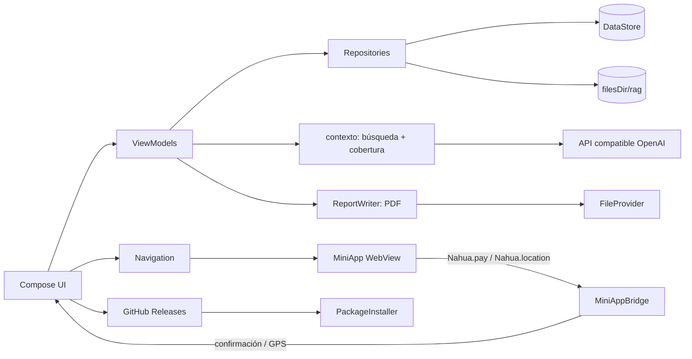

# Nahua · Super App de Colima

[](https://github.com/ruffol/nahua-superapp/actions/workflows/android.yml)
[](https://kotlinlang.org)
[](https://developer.android.com/jetpack/compose)
[](https://developer.android.com)
[](LICENSE)

Una **super app** hecha para **Colima**: pagos, transporte, un **bazar/trueque comunitario**,
mapa **offline** con GPS, mascota virtual y **Nahuanotoka**, un estudio *pixel art* que convierte tus PDFs
en mesas de trabajo por materia: resúmenes con página, ideas propias, correlación entre documentos,
figuras y un PDF listo para exponer. Todo en un solo binario, con un **runtime de mini-apps** y
**actualizaciones OTA** desde GitHub Releases.

> **Estado:** v0.15.0 — demo funcional, no lista para producción (sin backend, KYC ni PCI).

---

## Lo que incluye

- **Mapa offline de Colima** con teselas propias (z9–16, Natural Earth + calles, edificios y
  parques de OSM), estilo de papel cálido, **GPS en vivo** con coordenadas, velocidad y rumbo, y
  ruta directa con navegación al destino en la app de mapas del teléfono.
- **Bazar/Trueque comunitario**: cualquiera publica lo que ya no usa, la app lo **valora** (precio
  nuevo, estado, uso y accesorios) y el dueño decide si lo vende o lo abre a **trueque**. El botón
  **Truquear** avisa al dueño en su bandeja de Avisos; él ve el perfil del interesado con los objetos
  que ofrece y cierran el trato, con compensación en efectivo cuando los valores no emparejan.
- **Nahuanotoka (mesas de estudio)**: crea una mesa por materia, agrega varios PDFs, pide resumen,
  ideas, correlación o guion de exposición, revisa los tokens gastados y exporta el análisis a PDF.
- **Importación en segundo plano** con WorkManager: cierra la app y la indexación sigue.
- **Biblioteca en Room** con migración automática del índice anterior.
- **OCR local** (ML Kit) para PDFs escaneados, en segundo plano.
- **Búsqueda híbrida opcional** (BM25 + vectores con RRF) si configuras un endpoint `/embeddings`.
- **Actualizaciones OTA**: desde *Perfil → Versión* la app busca la última release en GitHub, la
  descarga y la instala sin volver a pasar un APK.
- **Hub de servicios**, cartera con DataStore, pagos entre mini-apps, escáner QR, avisos, perfil y
  tema claro/oscuro.
- **139 tests unitarios** y CI en GitHub Actions.

### Mini-apps y features

| App | Tipo | Qué hace | Integración |
| --- | --- | --- | --- |
| **Mapas** | mini-app | mapa offline z9–16, GPS en vivo, coordenadas y rutas a tianguis | Leaflet + GPS |
| **Bazar/Trueque** | mini-app | publicar, valorar, vender y truequear entre vecinos | `Nahua.pay` · `Nahua.valuate` · `Nahua.announce` |
| **Nahua Ride** | mini-app | destino, tarifa, ETA y viaje | `Nahua.pay` |
| **Pagar servicios** | mini-app | luz, agua e internet | `Nahua.pay` |
| **Axolote** | mini-app | mascota virtual con hambre, ánimo y niveles | `localStorage` |
| **Nahuanotoka** | feature nativa | mesas de estudio: resumen, ideas, correlación y PDF | HTTP + PDFBox |

---

## Mapa offline de Colima

- **Teselas propias** `{z}/{x}/{y}.png` en `assets/miniapps/mapa/tiles`: 2,489 teselas, ~8.1 MB.
  Las genera `.tmp/render_v3.py` a partir de Natural Earth (costa, carreteras, fronteras) y de
  OpenStreetMap (calles, edificios, parques, agua, ferrocarril y puntos de interés) en una paleta de
  barro. Se renderizan a 2× y se reducen con LANCZOS para que calles y etiquetas no salgan dentadas.
- **Cobertura por zoom**: z9–13 para todo el estado; z14–15 para el área metropolitana y z16 nativo
  para el núcleo Colima–Villa de Álvarez. La capa urbana se activa al llegar a z14 y la de barrio a
  z16, así que al acercarte aparecen edificios, parques, arroyos y nombres de calles y colonias en
  lugar de una imagen z13 estirada. z17 escala z16 ×2.
- **GPS en vivo**: `LocationProvider` usa `LocationManager` (sin Google Play Services) y emite un
  flujo con latitud, longitud, precisión, velocidad, rumbo y altitud. El mapa dibuja tu posición con
  pulso, círculo de precisión y cono de rumbo; puedes seguirte o moverte libremente por el mapa.
  El seguimiento se pausa al ocultar la app para no gastar batería.
- **Coordenadas**: la barra superior muestra lat/lng y precisión en tiempo real; la pestaña **GPS**
  añade velocidad, altitud, rumbo, antigüedad de la lectura y un botón para copiar las coordenadas.
- **Ir a un lugar**: busca un tianguis, una plaza, un hospital o escribe coordenadas
  (`19.2433, -103.7250`). El mapa traza la distancia directa con rumbo y ETA a pie y en auto, y
  **Navegar** abre la app de mapas del sistema con el destino ya puesto (`geo:`).
- **Rendimiento**: la capa base y las capas de detalle usan `maxNativeZoom`, `keepBuffer` y caché
  de WebView; no hay peticiones de red para el mapa. Si una tesela falta, el hueco es transparente y
  se ve la capa inferior, nunca un error 403.
- Atribución a OpenStreetMap en el mapa y en el pie.

## Bazar/Trueque comunitario

El tianguis de productores pasó a ser un **bazar de la comunidad**: cualquier persona publica lo que
ya no usa, la app le pone precio y el trueque es una decisión explícita de quien publica.

<p align="center">
  
  
</p>

1. **Publicar**: título, ícono, categoría, estado, meses de uso y precio de referencia (lo que costaba
   nuevo). La valoración se recalcula en vivo mientras escribes.
2. **Valorar**: `BarterValuator` combina el precio de referencia con la reventa de la categoría, el
   estado, el uso, los accesorios y la factura, y devuelve un valor con rango, confianza y desglose
   (*“−42 % reventa de bicis”*, *“−36 % por 3 años de uso”*). Además calcula el mínimo que conviene
   aceptar en un trueque.
3. **Habilitar trueque**: el interruptor sólo se enciende cuando el objeto ya está valorado. Sin ese
   paso el objeto se publica como venta normal.
4. **Truquear**: desde un objeto con trueque, el interesado elige qué de su bazar ofrece. La app
   compara las dos valoraciones (*A tu favor*, *Parejo*, *Pide compensación*) y **avisa al dueño** con
   un aviso nativo en **Avisos** y una propuesta en la pestaña **Trueques**.
5. **Ver el perfil del interesado**: desde el trato se abre su perfil con los objetos que tiene
   disponibles para truequear y el valor de cada uno.
6. **Cerrar el trato**: aceptar, pedir la diferencia en efectivo, rechazar o cancelar. Al aceptar, los
   dos objetos quedan apartados, la app propone punto de encuentro y el trueque se marca como
   completado cuando se entrega.

La aritmética vive en Kotlin (`core/model/Barter.kt`) y es la misma que expone el puente
`Nahua.valuate`: la página nunca decide cuánto vale un objeto por su cuenta. El bundle
(`assets/miniapps/bazar/`) guarda publicaciones y tratos en `localStorage`; el día que exista backend,
esa capa se sustituye sin tocar la UI.

## Nahuanotoka (mesas de trabajo)

**El problema:** tienes doce PDFs y una exposición en tres días. **La solución:** una mesa por
materia que guarda tus documentos, tu contexto, tus consultas y lo que llevas gastado.

1. **Servicios → Nahuanotoka → Nueva mesa** (nombre, materia y contexto: público, duración, tono).
2. **Agregar PDF o EPUB** (varios a la vez). Se limpian encabezados y números de página, se parten
   en bloques de 450 palabras con 50 de traslape y las figuras de los PDFs quedan como galería.
3. **Herramientas**: *Resumen*, *Ideas nuevas*, *Correlación*, *Guion de exposición*, *Glosario* y
   *Preguntas de repaso*. Con varios libros se envían los 3 mejores fragmentos de cada uno y la
   **Correlación** usa dos pasadas (una ficha por obra y luego el cruce). También puedes escribir la orden
   (“compárame los libros”, “hazme un resumen”) y el enrutador la ejecuta.
   Las respuestas llegan **en streaming**, token por token.
4. **Pregunta libre** en el compositor. Las respuestas citan `[Documento, p. N]`.
5. **PDF** exporta el análisis (portada, encabezados, tablas, fuentes y paginación) y lo comparte.
6. **Tokens**: entrada, salida y total por mesa y por respuesta.
7. **Caché de respuestas**: repite una consulta y no gasta tokens; la mesa acumula aciertos y
   tokens ahorrados.
8. **Copiar y descargar cada respuesta** en PDF, Markdown o TXT, con un lector a pantalla completa
   para las respuestas largas.
9. **Dictado local** con el reconocimiento del teléfono (modo offline cuando hay paquete de idioma).

Por defecto usa **DeepSeek V4.1 Flash** (`deepseek-v4.1-flash`) vía OpenCode Go: es el modelo más
barato para estudiar con muchos PDFs y su contexto alcanza para varias lecturas a la vez. Puedes
cambiar base URL y modelo a cualquier API compatible con OpenAI.

**Requiere API:** el texto se indexa en el teléfono, pero la redacción (resumen, ideas, correlación)
la hace siempre el modelo configurado. Si la API falla o falta la llave, la app muestra el error y
abre la configuración en lugar de inventar una respuesta.

Los documentos se quedan en el teléfono; sólo viajan la pregunta y los fragmentos elegidos.
Detalles de arquitectura, algoritmo y límites en [docs/RAG.md](docs/RAG.md).

## Actualizaciones OTA

1. **Perfil → Versión** abre el panel de actualizaciones (o *Actualizar app*).
2. La app consulta `releases/latest` del repo, compara versiones y muestra las notas.
3. **Descargar e instalar** baja el APK a caché, verifica el SHA-256 cuando GitHub lo publica y
   abre el instalador del sistema (la primera vez hay que permitir “instalar apps desconocidas”
   para Nahua).

Publicar una versión nueva:

```bash
git tag v0.5.1
git push origin v0.5.1
```

El workflow `release.yml` deriva la versión de la etiqueta (`0.5.1` → `versionCode=501`, con la
fórmula *mayor×10000 + menor×100 + parche*), compila y firma el APK y lo adjunta a la release. En el
teléfono basta con tocar *Buscar actualizaciones*.

> **Firma:** el repo incluye `signing/nahua-demo.keystore` a propósito para que las compilaciones de
> CI y las locales compartan firma y puedan actualizarse entre sí. Es una llave de demo, pública:
> reemplázala antes de distribuir fuera de este repositorio.

---

## Arquitectura

```
app/
└─ com.nahuanotoca.superapp
   ├─ core/
   │  ├─ data/            cartera, sesión, avisos, preferencias
   │  ├─ data/catalog/    catálogo de servicios
   │  ├─ design/          tema y componentes
   │  ├─ location/        LocationManager, fix puntual y flujo GPS en vivo
   │  ├─ miniapp/         manifiestos, registro y puente JS (pago, GPS, rutas, bazar y avisos)
   │  ├─ model/           modelos + WalletLedger (aritmética pura)
   │  ├─ navigation/      rutas
   │  ├─ rag/             PDF (texto y figuras), índice, contexto, LLM, PDF de salida
   │  ├─ update/          GitHub Releases + PackageInstaller
   │  └─ util/            formateo de fechas
   ├─ feature/            home, services, wallet, scan, inbox, profile, miniapp, search, rag, update
   │  └─ rag/            mesas de estudio (lista, detalle, herramientas, exportar PDF)
   ├─ ui/                 shell de navegación y fábrica de ViewModels
   ├─ NahuaApplication.kt
   └─ MainActivity.kt
```



Decisiones: DI manual (`AppContainer`), DataStore y JSON en `filesDir` en lugar de Room, dinero en
centavos, mini-apps HTML, recuperación léxica por raíz + cobertura por documento (sin embeddings) y
mapa raster offline para no depender de Google Play Services.

Orquestador de herramientas: [docs/AGENT.md](docs/AGENT.md). Evaluación con el corpus real: [docs/EVAL.md](docs/EVAL.md).

Informe técnico del RAG: [docs/Nahuanotoka-Informe-RAG.pdf](docs/Nahuanotoka-Informe-RAG.pdf).
Auditoría y línea base (plan Nahua AI): [docs/AUDIT.md](docs/AUDIT.md) · [docs/BASELINE.md](docs/BASELINE.md) · [corpus de evaluación](docs/eval/README.md).

Más detalle: [docs/ARCHITECTURE.md](docs/ARCHITECTURE.md), [docs/MINIAPP_SDK.md](docs/MINIAPP_SDK.md)
y [docs/RAG.md](docs/RAG.md).

---

## Cómo compilar

Requisitos: JDK 17 y Android SDK con la plataforma **35**.

```bash
echo "sdk.dir=/ruta/a/Android/Sdk" > local.properties
./gradlew assembleDebug        # APK de debug
./gradlew testDebugUnitTest    # 139 tests
./gradlew installDebug
```

El APK queda en `app/build/outputs/apk/debug/app-debug.apk`.

---

## Privacidad

- Los PDFs se procesan en el dispositivo; solo se envían pregunta y fragmentos a tu API.
- La ubicación se usa únicamente mientras el mapa está abierto (o al tocar “Mi ubicación” en el
  inicio) y nunca se envía a un servidor. Al pulsar **Navegar**, el destino se comparte con la app
  de mapas que elijas.
- La API key se guarda en el almacenamiento privado de la app (Keystore recomendado en producción).

---

## Hoja de ruta

- [ ] Backend real (cuentas, ledger de doble entrada, webhooks) y OAuth/OIDC.
- [ ] Embeddings on-device para búsqueda semántica en Nahuanotoka.
- [ ] OCR on-device para los PDFs escaneados de las mesas.
- [ ] Firma de mini-apps y permisos granulares.
- [ ] CameraX + ML Kit para QR real.
- [ ] Módulos Gradle y Hilt.

## Contribuir

Lee [CONTRIBUTING.md](CONTRIBUTING.md).

## Licencia

MIT © 2026 Nahua contributors. Ver [LICENSE](LICENSE).