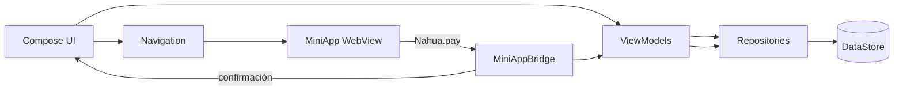

# Nahua · Super App Android

[](https://github.com/ruffol/nahua-superapp/actions/workflows/android.yml)
[](https://kotlinlang.org)
[](https://developer.android.com/jetpack/compose)
[](https://developer.android.com)
[](LICENSE)

Una **super app** al estilo de las apps chinas (WeChat, Alipay, Meituan): un solo binario que
agrupa pagos, transporte, comida, servicios del hogar, gobierno y ocio, con un **runtime de
mini-apps** para que terceros publiquen experiencias sin volver a publicar la app.

Este repositorio es el *shell* funcional: hub de servicios, cartera con pagos reales dentro de la
app, escáner QR, bandeja de avisos, perfil y cuatro mini-apps de demostración que cobran a través
del puente de pagos.

> **Estado:** v0.1.0 — demo de producto, no lista para producción. No hay backend, KYC, PCI ni
> firma de mini-apps todavía. Ver la hoja de ruta al final.

---

## Vista rápida

```
Inicio                Cartera              Mini app
┌───────────────┐    ┌───────────────┐    ┌───────────────┐
│ Hola, Ana  🔔 │    │ Cartera       │    │ ✕  Nahua Ride │
│ [ Buscar... ] │    │ $2,500.00     │    │ ¿A dónde?     │
│ Saldo $2,500  │    │ Recargar ...  │    │ Centro  ▸ $58 │
│ ┌──┬──┬──┬──┐ │    │ Movimientos   │    │ [ Pedir viaje]│
│ │🚗│🍜│🧾│🎬│ │    │ Café  −$85.00 │    │  pago nativo  │
│ └──┴──┴──┴──┘ │    └───────────────┘    └───────────────┘
└───────────────┘
```

---

## Qué incluye

- **Hub de servicios** con catálogo único, categorías, búsqueda y accesos rápidos.
- **Cartera Nahua** con saldo, recargas y movimientos persistidos (DataStore, montos en centavos).
- **Pagos desde mini-apps**: las páginas HTML piden `Nahua.pay({...})`; la app muestra una hoja de
  confirmación, debita la cartera y devuelve el `transactionId` al JavaScript.
- **Runtime de mini-apps** basado en WebView aislado, servido por `WebViewAssetLoader` en un origen
  `https://` (sin `file://`, sin tráfico en claro).
- **Escáner QR** con flujo de pago simulado (listo para CameraX + ML Kit).
- **Avisos**, **perfil**, tema claro/oscuro y preferencias persistentes.
- **Tests unitarios** de dinero, ledger, catálogo y formateo; **CI** en GitHub Actions.

### Las cuatro mini-apps de demo

| Mini app | Qué hace | Pago |
| --- | --- | --- |
| **Nahua Ride** | elige destino, ve tarifa y ETA, pide el viaje | `Nahua.pay` |
| **Nahua Food** | menú, carrito y checkout | `Nahua.pay` |
| **Pagar servicios** | luz, agua e internet con montos y vencimientos | `Nahua.pay` |
| **Cine** | cartelera, funciones, boletos | `Nahua.pay` |

---

## Arquitectura

```
app/
└─ com.nahuanotoca.superapp
   ├─ core/
   │  ├─ data/            repositorios (cartera, sesión, avisos, preferencias)
   │  ├─ data/catalog/    catálogo de servicios
   │  ├─ design/          tema, tipografía, componentes compartidos
   │  ├─ miniapp/         manifiestos, registro y puente JS
   │  ├─ model/           modelos + WalletLedger (aritmética pura)
   │  ├─ navigation/      rutas
   │  └─ util/            formateo de fechas
   ├─ feature/            home, services, wallet, scan, inbox, profile, miniapp, search
   ├─ ui/                 shell de navegación y fábrica de ViewModels
   ├─ NahuaApplication.kt
   └─ MainActivity.kt
```



Decisiones clave:

- **Sin framework de DI** por ahora: `AppContainer` manual. Migrar a Hilt es mecánico y no toca
  features (documentado en `docs/ARCHITECTURE.md`).
- **DataStore + org.json** en lugar de Room para mantener el build simple; el repo expone flujos,
  así que el cambio de motor no afecta la UI.
- **Dinero en centavos (`Long`)** y `WalletLedger` puro para poder testear las reglas sin Android.
- **Mini-apps en HTML** para iterar rápido; el contrato es `assets/miniapps/index.json`.

Más detalle: [docs/ARCHITECTURE.md](docs/ARCHITECTURE.md) y [docs/MINIAPP_SDK.md](docs/MINIAPP_SDK.md).

---

## Cómo compilar

Requisitos:

- JDK 17
- Android SDK con la plataforma **35** (`compileSdk = 35`, `targetSdk = 35`, `minSdk = 26`)

```bash
# 1. Configura el SDK (ruta local, no se versiona)
echo "sdk.dir=/ruta/a/Android/Sdk" > local.properties

# 2. Compila el APK de debug
./gradlew assembleDebug

# 3. Corre los tests unitarios
./gradlew testDebugUnitTest

# 4. Instala en un emulador o dispositivo conectado
./gradlew installDebug
```

El APK queda en `app/build/outputs/apk/debug/app-debug.apk`.

---

## Flujo de pago (de punta a punta)

1. La mini-app llama `Nahua.pay({ amount, concept, merchant })`.
2. `MiniAppBridge` valida el monto y lo publica en el hilo principal.
3. La app muestra una hoja de confirmación con el saldo disponible.
4. Al confirmar, `WalletRepository` debita el saldo y registra el movimiento.
5. El resultado (`transactionId`, `balanceCents`) se devuelve al JavaScript y la mini-app muestra
   su pantalla de éxito.

Si el usuario cancela o no hay saldo, el puente resuelve el `Promise` con
`{ status: 'error', error: 'cancelled' | 'insufficient_funds' }`.

---

## Hoja de ruta

- [ ] Backend real (cuentas, ledger doble entrada, webhooks) y OAuth/OIDC.
- [ ] Mini-apps firmadas (manifiesto + hash) y permisos granulares.
- [ ] CameraX + ML Kit para escaneo QR real.
- [ ] Módulos Gradle (`core:design`, `core:data`, `feature:*`) y Hilt.
- [ ] Pagos con tarjeta/SPEI, KYC y cumplimiento PCI.
- [ ] Notificaciones push y centro de soporte.
- [ ] Capturas de pantalla automatizadas (emulador + Compose UI tests).

---

## Contribuir

Lee [CONTRIBUTING.md](CONTRIBUTING.md). Las ideas y los issues son bienvenidos.

## Licencia

MIT © 2026 Nahua contributors. Ver [LICENSE](LICENSE).