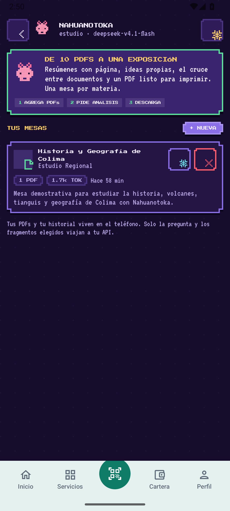
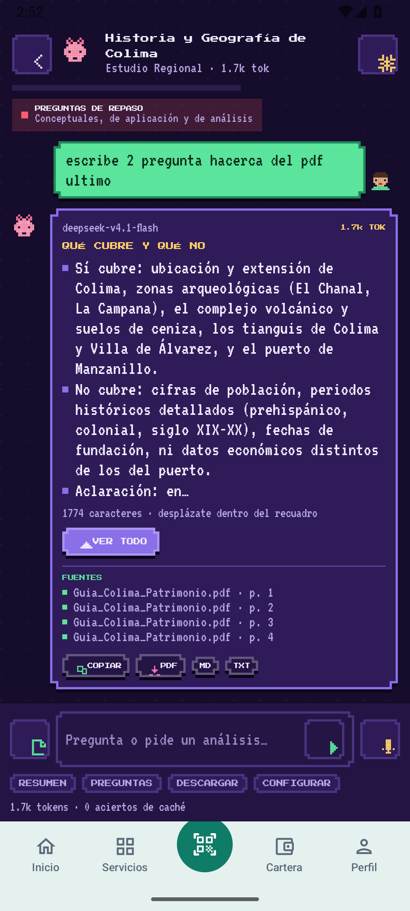
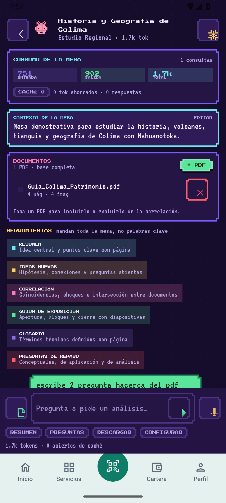
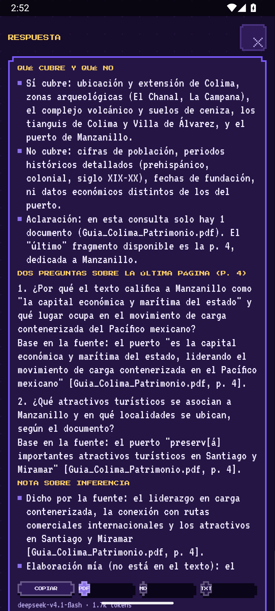

# Nahuanotoka · mesas de trabajo con tus PDFs

> **Informe técnico completo (PDF):** [Nahuanotoka-Informe-RAG.pdf](Nahuanotoka-Informe-RAG.pdf)
> — funcionamiento, tecnologías, infraestructura, límites y revisión con mejoras priorizadas.
> Fuente editable: [informe-rag.html](informe-rag.html).

## El problema que resuelve

Eres estudiante. Tienes una exposición en tres días y doce PDFs: tres capítulos del libro, dos
artículos, las diapositivas de la clase, un par de lecturas escaneadas y tus apuntes exportados.
Lo normal es abrir cada archivo, buscar con Ctrl+F, copiar y pegar, resumir a mano y perder la
página de la cita. Al final expones con datos que no puedes respaldar.

Nahuanotoka convierte ese montón en una **mesa de trabajo por materia**:

| Sin la app | Con Nahuanotoka |
| --- | --- |
| Abres 12 PDFs y pierdes 2 horas resumiendo | Pides *Resumen* y salen los puntos clave con página |
| Copias citas y olvidas de dónde salieron | Cada afirmación viaja con `[Documento, p. N]` |
| No sabes si dos lecturas se contradicen | *Correlación* cruza los documentos y marca coincidencias, choques e intersección |
| Las ideas propias se quedan en la cabeza | *Ideas nuevas* separa lo textual de lo inferido |
| El resumen vive en una nota que no puedes imprimir | *PDF* genera un documento paginado y lo comparte |
| No sabes cuánto gastas en la API | Cada mesa y cada respuesta muestran sus tokens |

La app **no inventa**: si el dato no está en los documentos, lo dice y te señala qué archivo revisar.

## Capturas

| Mesas | Chat |
| --- | --- |
|  |  |

| Herramientas | Lector completo |
| --- | --- |
|  |  |

## Qué es una mesa de trabajo

Una mesa es una materia o una exposición. Guarda:

- **Nombre y materia** (“Historia de México · bloque 3”).
- **Contexto**: instrucciones tuyas para el modelo (público, duración, tono, enfoque). Se manda en
  cada consulta, así que no repites “es para exponer en 10 minutos” cada vez.
- **Documentos**: los PDFs de esa materia, con sus páginas, fragmentos y figuras.
- **Conversación**: lo que pediste y lo que respondió, con modelo, tokens y fuentes.
- **Consumo**: tokens de entrada, de salida y total, más el número de consultas.

Puedes tener tantas mesas como materias curses. Todo se procesa en el teléfono; sólo la pregunta y
los fragmentos elegidos viajan a tu API.

## Flujo de uso

1. **Servicios → Nahuanotoka → Nueva mesa.** Ponle nombre, materia y contexto.
2. **Agregar PDF o EPUB** (varios a la vez). Cada archivo se indexa **en segundo plano** con WorkManager: puedes salir de la app y el trabajo continúa; al volver verás el progreso por libro. Si el PDF es un escaneo, el worker lo detecta y aplica **OCR local** página por página.
   se indexan en el dispositivo y, si tienen imágenes incrustadas, aparecen como **figuras** listas
   para tus diapositivas. Al final se resume cuántos entraron, cuántas páginas y cuántas figuras.
3. **Herramientas de estudio** (una consulta cada una):

   | Herramienta | Qué devuelve |
   | --- | --- |
   | Resumen | Idea central, 5–8 puntos con página y 3 conceptos para explicar con tus palabras |
   | Ideas nuevas | 6 ideas con etiqueta *apoyo textual* o *inferencia propia* |
   | Correlación | Tabla por eje y por obra con cita por celda (“no se pronuncia” si falta), tensiones, intersección y huecos |
   | Guion de exposición | Apertura, bloques con diapositiva + qué decir + cita, cierre y preguntas del público |
   | Glosario | 10–15 términos definidos con el texto y su página |
   | Preguntas de repaso | 8 preguntas con respuesta modelo y cita |

4. **Pregunta libre** en el compositor (“¿por qué cayó el porfiriato?”, “compárame las dos
   lecturas”).
5. **PDF**: exporta el último análisis (o toda la conversación de la mesa) a un PDF paginado con
   portada, tabla, fuentes y pie de página, y compártelo con WhatsApp, Drive o la impresora.
6. **Correlaciona sólo una parte**: toca los PDFs que quieras incluir; si no seleccionas ninguno, se
   usan todos.

## Hoja de ruta propuesta vs. lo que hay

Comparación punto por punto con la ruta de 10 días (extracción → embeddings → Top-K → UI):

| Fase de la ruta | En la app | Nota |
| --- | --- | --- |
| PDFBox-Android para PDFs | ✅ `PdfExtractor` | Ya estaba |
| Epublib para EPUBs | ✅ sin librería: `EpubParser` lee el ZIP + OPF + spine y convierte cada capítulo en una “página” | Cero dependencias nuevas |
| Texto página por página | ✅ | También figuras incrustadas |
| Limpieza de texto | ✅ `TextCleaner`: encabezados/pies repetidos, números de página sueltos, guiones de corte de línea y saltos | Antes solo se colapsaban espacios |
| Chunks de 400–500 palabras con 50 de solape | ✅ 450 / 50 | Antes: ~150 palabras por caracteres |
| Metadatos por bloque | ✅ `libroId`, `tituloLibro`, `numeroPagina` | Se guardan con el índice |
| Embeddings locales (.tflite/.onnx) | ❌ pendiente | Requiere modelo (~90 MB) + MediaPipe/ONNX Runtime; el build offline no puede descargar esas dependencias |
| ObjectBox + `@HnswIndex` | ❌ pendiente | Hoy el índice es JSON por mesa; suficiente para decenas de libros |
| WorkManager para indexar en segundo plano | ⚠️ pendiente | La indexación corre en un coroutine con progreso visible; si sales de la app se cancela |
| Top-K **por libro** (3 c/u) | ✅ `ContextBuilder.balanced` | Antes era un top-K global que una obra larga podía acaparar |
| Prompt con atribución por libro | ✅ | Cada bloque lleva `[Documento, p. N]` |
| Cliente OpenCode con Bearer | ✅ `ChatClient` | `HttpURLConnection`, sin Retrofit |
| Barra de progreso de indexación | ✅ libro N de M + páginas procesadas | |
| Streaming (`"stream": true`) | ✅ SSE token por token | Antes: esperar la respuesta completa |
| Citas verificables | ✅ | Documento + página bajo cada respuesta |

Las dos piezas que faltan (embeddings + base vectorial) son las únicas que exigen dependencias
pesadas. Cuando haya red en el build, el orden recomendado es: ONNX Runtime + `all-MiniLM-L6-v2`
cuantizado a int8 (~25 MB), vectores en un archivo binario propio con HNSW, y `WorkManager` para
indexar en segundo plano. La búsqueda léxica actual se queda como respaldo para consultas con
nombres propios o cifras, donde los embeddings suelen fallar.

## Cómo decide qué leer (y por qué antes fallaba)

El motor anterior sólo comparaba palabras exactas contra el texto. Con un PDF de 8 páginas y la
pregunta “Dame un resumen”, los términos útiles eran `dame` y `resumen`: ninguna aparece en el
documento, así que devolvía *“No encontré pasajes relevantes”*. Lo mismo con “¿De qué trata?”.

Ahora hay tres capas:

1. **Búsqueda léxica por raíz (BM25 ligero).** “obligacion” encuentra “obligaciones”; “contamina”,
   “contaminación”. El nombre del documento también puntúa.
2. **Cobertura por documento.** Las tareas globales (resumen, ideas, correlación, guion, glosario,
   preguntas) no buscan palabras: reparten el presupuesto de fragmentos entre **todos** los
   documentos y los intercalan, para que la mesa completa entre al contexto.
3. **Respaldo honesto.** Si una pregunta puntual no tiene ninguna coincidencia, no se rinde: manda
   los fragmentos más representativos y marca la consulta como *débil*, de modo que el modelo
   empiece aclarando qué sí cubre el material y qué no.

Presupuesto por consulta: con **varios libros** se toman los **3 mejores fragmentos de cada uno**
(intercalados por ronda, máximo 12 bloques) y cada bloque se recorta a ~1 200 caracteres; el total
ronda 14 000 caracteres. Con un solo libro se usa `topK` (8 por defecto).

## Caché de respuestas (ahorrar tokens)

Cada consulta genera una clave determinista con el modelo, la tarea, la pregunta normalizada, el
alcance de documentos, la versión del índice y —sólo en el chat— el historial. En las tareas de
estudio el historial queda fuera: repetir “resumen” acierta aunque después hayan pasado otras
consultas. Si repites exactamente la misma consulta:

- no se llama a la API,
- la respuesta sale de la caché local (`filesDir/studio/cache/<mesa>.json`),
- la tarjeta se marca con **CACHÉ** y los tokens cuentan cero,
- la mesa acumula *aciertos de caché* y *tokens ahorrados*, visibles en el panel de consumo.

La caché caduca a los 14 días, guarda hasta 40 respuestas por mesa y se puede vaciar desde el
botón **VACIAR** del panel de consumo. La última respuesta tiene **REGENERAR** (ignora la caché) y la
tarjeta de progreso tiene **DETENER**, que cancela la petición y cierra la conexión.

## Exportar cada respuesta

Cada tarjeta del asistente tiene **COPIAR** y tres descargas: **PDF** (maquetado con portada,
tablas y fuentes), **MD** (Markdown para Obsidian/Notion) y **TXT** (texto plano). El lector a
pantalla completa repite las acciones, para que puedas copiar o bajar el texto completo sin salir
del recuadro. Los archivos se escriben en la caché de la app y se comparten con `FileProvider`.

## Respuestas largas sin invadir el chat

Las respuestas se muestran recortadas a ~430 caracteres con el botón **VER TODO**. Al tocarlo se
abre un lector a pantalla completa: el chat queda inmóvil detrás y el texto se desplaza dentro del
recuadro, con las acciones fijas abajo.

## Dictado local

El micrófono del compositor usa `SpeechRecognizer` con `EXTRA_PREFER_OFFLINE`, así que si el
teléfono tiene el paquete de idioma español descargado, el audio no sale del dispositivo. Si no hay
servicio de reconocimiento o falta permiso, la app lo dice y sigues escribiendo.

## Comparación en dos pasadas

La tarea **Correlación** con dos o más obras no manda todo el material en una sola llamada. Hace:

1. **Ficha por obra**: para cada libro se eligen 4 fragmentos representativos y se pide una ficha de
   3–5 viñetas con sus citas y sus “ejes que toca”. Si el libro no dice nada del tema, la ficha dice
   *“No se pronuncia sobre el tema”*.
2. **Cruce**: una segunda llamada recibe sólo las fichas y produce la tabla por eje y por obra, las
   tensiones con las dos citas, la intersección y los huecos.

Cuesta N+1 llamadas en vez de 1, pero la respuesta compara en lugar de resumir. El progreso muestra
qué obra se está procesando y la tarjeta final se marca **2 PASADAS**.

## Evidencia y ventanas de contexto

Cada fragmento recuperado se devuelve como **evidencia**: `RetrievedEvidence(chunkId, documento,
título, página, texto, score, estrategia)`. El `chunkId` es estable (sha-256 corto del texto) y se
escribe al importar, así una cita puede rastrearse aunque cambie el orden del índice.

El bloque ya **no se recorta a ciegas**: se guarda el texto completo del fragmento y, al construir el
contexto, se eligen hasta **dos ventanas de oraciones** contiguas con mayor densidad de términos
(pesando más los términos raros). Si una página tiene dos pasajes relevantes lejanos, ambos entran.
Además:

- se añade el inicio del fragmento siguiente cuando la ventana termina en el borde;
- se deduplican solapes comparando n-gramas de 6 palabras;
- el presupuesto sigue siendo ~14 000 caracteres, pero ahora por bloque de 1 200 caracteres útiles.

La estrategia queda en el turno (`busqueda`, `cobertura`, `balanceado`) y, cuando no hubo ninguna
coincidencia, el chat muestra el chip **EVIDENCIA DÉBIL** y el prompt obliga al modelo a declararlo.

## Tokens y costo

- El campo `usage` de la respuesta del proveedor se guarda por turno y se acumula por mesa.
- Si el proveedor no lo devuelve, se estima con ~4 caracteres por token y se indica igual.
- Se muestran en la tarjeta de la mesa (entrada / salida / total), en la lista de mesas y en cada
  respuesta.
- Con `deepseek-v4.1-flash` (0.30 USD por millón de entrada y 1.20 por millón de salida) una mesa de
  estudio típica cuesta centavos: una consulta con 8 fragmentos ronda 2 500–4 000 tokens de entrada.

## Dirección visual

El estudio usa una estética pixel art: tipografía *Press Start 2P* (títulos) y *VT323* (texto),
paneles morados con esquinas escalonadas, bordes de 2 px, sprites dibujados con `PixelSprite` y
un fondo de puntos. Los recursos viven en `core/design/Pixel.kt` y `PixelArt.kt`; las fuentes
son OFL y sus licencias están en `assets/licenses/`.

## Modelo por defecto

> **Todo el análisis lo genera el modelo vía API.** La app indexa los PDFs y elige los fragmentos,
> pero la síntesis (resumen, ideas, correlación, guion…) siempre viene del proveedor configurado.
> Si falta la llave o la API falla, la mesa muestra el error y abre la configuración: **no hay
> respuestas de respaldo generadas en el teléfono**.

| Campo | Valor |
| --- | --- |
| Base URL | `https://opencode.ai/zen/go/v1` |
| Modelo | `deepseek-v4.1-flash` |
| Endpoint | `{baseUrl}/chat/completions` |
| Auth | `Authorization: Bearer <api key>` |

Presets en la hoja de ajustes: `deepseek-v4.1-flash` (recomendado), `deepseek-flash`,
`deepseek-v4-pro`, `kimi-k2.7-code`, `glm-5.1`, `mimo-v2.5-pro`. El campo es editable: cualquier
endpoint compatible con OpenAI (OpenAI, OpenRouter, Ollama, vLLM) funciona. Si tu proveedor no
acepta `max_tokens`, baja el ajuste o usa otro modelo.

## Arquitectura

```
SAF (OpenDocument)
      │
      ▼
PdfExtractor (PDFBox-Android)      texto por página + figuras incrustadas
      │
      ├── TextCleaner              limpia encabezados, pies y números de página
      ├── TextChunker              450 palabras por bloque, 50 de traslape
      │        └── filesDir/rag/<mesa>/doc_<id>.chunks.json
      └── Bitmap JPEG              filesDir/rag/<mesa>/fig_<id>_<n>.jpg
      │
      ▼  (al consultar)
ContextBuilder                    búsqueda por raíz o cobertura por documento
      │
      ▼
ChatClient (POST /chat/completions)  → texto + usage
      │
      ├── filesDir/studio/chats/<mesa>.json   historial
      ├── filesDir/studio/mesas.json          mesas + tokens
      └── ReportWriter → PDF en caché → FileProvider → compartir
```

| Clase | Responsabilidad |
| --- | --- |
| `PdfExtractor` | Texto por página y figuras (≥160 px, reescaladas a 900 px) en una sola pasada |
| `TextChunker` | Normaliza espacios y parte en fragmentos con traslape, cortando en palabras |
| `Retriever` | Tokeniza sin acentos ni muletillas, puntúa por raíz y nombre de documento |
| `ContextBuilder` | Elige fragmentos: búsqueda puntual, cobertura global o respaldo débil |
| `StudioPrompts` | System prompt con el contexto de la mesa + formato de cada herramienta |
| `ChatClient` | HTTP mínimo compatible con OpenAI; devuelve `usage` y errores accionables |
| `StudioRepository` | Mesas, contexto, historial y contadores de tokens en JSON |
| `RagRepository` | Documentos y figuras por mesa |
| `ReportWriter` | PDF A4 con Canvas: portada, encabezados, viñetas, tablas, fuentes y paginación |

## Almacenamiento

```
filesDir/nahua-library.db   Room: documents, chunks, figures (cascada + índices)
filesDir/rag/<mesaId>/
└─ fig_<id>_<n>.jpg         figuras incrustadas (los JPEG siguen en disco)

filesDir/rag-legacy/<mesa>/ JSON anterior, archivado tras migrar

filesDir/studio/
├─ mesas.json             [ { id, name, subject, context, accent, usage, requests } ]
└─ chats/<mesaId>.json    [ { role, text, taskId, model, tokens, sources[] } ]

cacheDir/reports/*.pdf    PDF generado (compartido con FileProvider)
```

La biblioteca vive en **Room** desde 0.10.0; el índice JSON anterior se migra una sola vez al abrir la mesa.

Si importas el mismo archivo dos veces, la app compara la huella SHA-256 y **no lo indexa de nuevo**.
Un archivo distinto con el mismo nombre se guarda como versión nueva del documento.

Los documentos del formato anterior (sin mesas) se migran solos a la mesa *“Mis documentos”* la
primera vez que abres la app.

## Privacidad

- El PDF nunca se sube: se extrae en el teléfono y sólo vive su texto y sus figuras en el
  almacenamiento privado.
- No se envían documentos completos: un máximo de `topK` fragmentos por consulta.
- La API key se guarda en Preferences DataStore privado; para producción conviene Keystore.
- Los errores de red no reintentan solos, para no duplicar consumo.

## Límites conocidos

| Límite | Motivo |
| --- | --- |
| 300 páginas por PDF | Tiempo de extracción en gama baja |
| OCR hasta 120 páginas | 1–3 s por página en el dispositivo |
| PDFs con texto | Los escaneados necesitan OCR previo |
| 3 fragmentos por libro / ~14 000 caracteres | Costo y ventana del proveedor |
| 450 palabras por bloque | Coincide con la ruta de estudio (400–500) |
| 12 figuras por PDF | Memoria del teléfono |
| 80 turnos por mesa | Tamaño del historial |
| Sin API key o sin red | No hay análisis: el modelo no corre en el teléfono |

## Diagnóstico

| Síntoma | Causa probable |
| --- | --- |
| “no tiene texto seleccionable” | PDF escaneado; aplica OCR |
| “La búsqueda no encontró coincidencias” | La mesa responde con lo más representativo; revisa si el tema está en tus PDFs |
| 401/403 | API key inválida o sin permisos |
| 404 | Base URL o modelo incorrectos |
| 413/400 | Contexto demasiado grande o `max_tokens` no soportado: usa flash |
| 429 | Límite del proveedor; espera o cambia de modelo |

## Tests

- `ContextBuilderTest`: cobertura entre documentos, respaldo débil, presupuesto de caracteres,
  selección para correlación.
- `RetrieverTest`: ranking, raíces y plurales, muletillas (“dame un resumen”), acentos, límite.
- `TextChunkerTest`: tamaños, traslape y páginas.
- `RagSettingsTest`: endpoint y validación.

```bash
./gradlew testDebugUnitTest
```